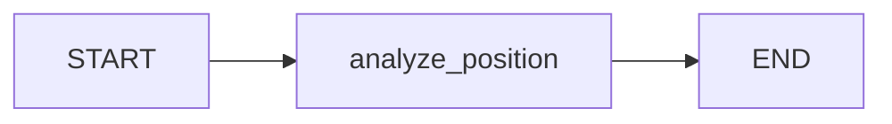

# Position coach

A standalone async LangGraph workflow using the OpenAI Responses API, `gpt-6-astra`, and `reasoning.effort="xhigh"`. The replay screen calls it through `POST /api/coach/analyze` when Run coach is pressed. The Python interface, CLI, and LangSmith Studio use the same graph definition.



`analyze_position` is the first node. It wraps the existing Responses request and returns plain JSON-compatible state: `fen`, `ascii_board`, `side_to_move`, `text`, `response_id`, `model`, and `usage`. Input is only `fen`; the board is always derived from that position. The existing `CoachAnalysis` Python result and HTTP response shape are preserved.

## Flow

1. Receive the selected position's complete FEN.
2. Validate it with python-chess and generate a coordinate-labeled ASCII board. White is always at the bottom; letter case identifies piece color.
3. Send the exact contents of `system_prompt.md` as a system message, followed by a user message containing the FEN, ASCII board, and side to move.
4. Return the completed Markdown answer, response ID, actual model, position, and token usage. The two-section teaching format comes from the supplied prompt.

An optional ASCII board can also be supplied. It must match the FEN, either as the coordinate-labeled output of `CoachPosition.from_fen(fen).ascii_board` or the plain eight rows from `str(chess.Board(fen))`. Whitespace differences are accepted. The canonical board is always sent to OpenAI, preventing mismatched or flipped inputs.

No PGN, played move, next move, result, game history, engine evaluation, or tools are sent. Each call is independent. Answers are not engine-verified, and the module does not rewrite or enforce the Markdown section structure after generation.

## Web endpoint

`POST /api/coach/analyze` accepts only `{ "fen": "<complete selected-position FEN>" }`. It saves a completed answer in PostgreSQL before returning `fen`, `text`, `model`, `response_id`, and `created_at`. Extra fields, including student questions, are rejected. The server derives the ASCII board and keeps the prompt and API key out of the browser.

`GET /api/coach/feedback?fen=<URL-encoded FEN>` returns the latest saved answer or `null`. Game detail responses include `coach_responses`, keyed by the complete FEN, so replays restore feedback without another model request. The `coach_feedback` table retains all successful generations, including token usage; reruns append rather than overwrite. Database failure returns 503 and never claims an unsaved answer was saved. The standalone Python/CLI/Studio interfaces remain independent of database storage; persistence belongs to the web endpoint.

The backend allows one active coach request per application process, returning 409 for overlapping requests. Invalid positions return 422, configuration/authentication problems 503, provider limits 429, timeouts 504, and other upstream failures 502. Provider error bodies are not exposed. Requests are not automatically retried.

The UI pauses autoplay when Run coach is pressed and shows progress. Moving to another position displays that position's saved answer; refreshing or reopening the replay restores it from PostgreSQL. The previous answer remains visible during a rerun and survives a failed generation. Student questions remain local drafts and are never sent. Leaving the replay aborts the browser request; it does not guarantee cancellation of a generation already running at OpenAI. A completed server request is still saved independently of the browser connection.

## Files

- `system_prompt.md`: the user's supplied prompt, copied byte for byte.
- `position.py`: FEN validation, ASCII rendering, and the position message.
- `settings.py`: fixed model/reasoning settings and runtime limits.
- `graph.py`: input/state schemas, the first node, graph builder, and Studio export.
- `responses.py`: request construction, traced async SDK adapter, and response handling.
- `service.py`: compatible Python interface that invokes the graph.
- `routes.py`: the position-only HTTP endpoint, concurrency guard, and safe error mapping.
- `__main__.py`: standalone command-line entry point and dry-run preview.

## Use from Python

Set `OPENAI_API_KEY` in the backend process environment, then call:

```python
from backend.coach import open_coach

async def analyze_selected_position(fen: str):
    async with open_coach() as coach:
        analysis = await coach.analyze(fen)
        return analysis.text
```

The context manager owns and closes the SDK client. It can be kept open for multiple calls. To integrate with a future application lifespan or a test transport, construct `Coach(existing_async_openai_client)` instead; the caller then owns the client.

`coach.graph` exposes the compiled graph for streaming/debugging. `coach.analyze(fen, config={"tags": ["replay"], "metadata": {"game_id": "..."}})` accepts optional LangGraph run configuration; keep credentials out of metadata and graph state.

## LangSmith tracing

The Responses client uses LangSmith's `wrap_openai`. When tracing is enabled, a successful run has this hierarchy:

```text
chess_coach
  analyze_position
    OpenAI Responses (LLM request, output, token usage)
```

Graph/node failures and provider failures are captured at their respective levels. Set these values in the ignored project `.env` to send traces:

```dotenv
LANGSMITH_TRACING=true
LANGSMITH_API_KEY=<your LangSmith API key>
LANGSMITH_PROJECT=chess-coach
LANGSMITH_ENDPOINT=https://api.smith.langchain.com
```

Use your LangSmith region's endpoint if different. Set `LANGSMITH_WORKSPACE_ID` if your key is linked to multiple workspaces. Restart the backend or Studio server after changing these values. For Docker, rebuild with `docker compose up --build -d`; Compose passes the tracing variables to the backend.

The example configuration defaults to `LANGSMITH_TRACING=false`, so the coach and game library work without LangSmith credentials. With tracing enabled, prompts (including the selected position), answers, timing, errors, and usage are sent to LangSmith. OpenAI's `store=False` setting does not disable LangSmith trace storage.

## Run in LangSmith Studio

From the repository root on Windows, install the development dependencies and start the local Agent Server:

```powershell
.\.venv\Scripts\python -m pip install -r backend\requirements-dev.txt
$env:PYTHONUTF8 = "1"
.\.venv\Scripts\langgraph dev --host 127.0.0.1 --port 2024
```

The UTF-8 setting also prevents the CLI's Unicode banner from failing in Windows terminals/pipes. `langgraph.json` exports `backend.coach.graph:graph` as `chess_coach` and loads `.env`. Graph loading and inspection require no OpenAI key; running a valid position requires `OPENAI_API_KEY`.

Open [Studio connected to the local server](https://smith.langchain.com/studio/?baseUrl=http://127.0.0.1:2024), select **chess_coach**, and submit:

```json
{
  "fen": "rnbqkbnr/pppppppp/8/8/8/8/PPPPPPPP/RNBQKBNR w KQkq - 0 1"
}
```

Use graph mode to inspect the node, inputs, outputs, and state. This position workflow does not expose a chat/messages interface. Each submitted run makes one paid Responses call; it does not automatically retry. Agent Server manages Studio threads/checkpoints, with local development data in ignored `.langgraph_api/`.

The existing FastAPI app executes the graph directly; it does not need this second server. Both entry points emit LangSmith traces when enabled, but app requests do not create Studio threads. Studio's server is a separate development surface and does not share FastAPI's single-request concurrency guard.

## Add the next node

Extend `CoachState` and `build_coach_graph()` in `graph.py`. Register the new node, replace `analyze_position -> END` with `analyze_position -> your_node`, and connect that node to `END`. Nodes return only their updated state fields. Preserve the current output fields while the web endpoint still uses `CoachAnalysis`.

Keep clients/settings outside graph state and create any needed clients lazily. Do not hard-code a checkpointer in the exported graph: Studio supplies one, while direct application calls currently remain independent. A new FEN in a reused Studio thread generates a fresh board and does not send old analysis to OpenAI.

## Run without the UI

From the repository root, preview the complete request without credentials or network access:

```powershell
.\.venv\Scripts\python -m backend.coach --fen "rnbqkbnr/pppppppp/8/8/8/8/PPPPPPPP/RNBQKBNR w KQkq - 0 1" --dry-run
```

To make a real, billable request, set `OPENAI_API_KEY` in your local environment and omit `--dry-run`. Add `--ascii-file path/to/board.txt` to validate an existing ASCII representation alongside the FEN. The CLI prints the coach's answer to stdout; errors go to stderr with a nonzero exit status.

Docker Compose passes `OPENAI_API_KEY`, `COACH_MAX_OUTPUT_TOKENS`, and `COACH_TIMEOUT_SECONDS` from the shell or the project's ignored `.env` file. After rebuilding the image, the same command can be run in a one-off container:

```powershell
docker compose run --rm --no-deps app python -m backend.coach --fen "rnbqkbnr/pppppppp/8/8/8/8/PPPPPPPP/RNBQKBNR w KQkq - 0 1" --dry-run
```

The FastAPI application loads the project `.env` at startup without overriding explicit process environment variables. The standalone CLI reads environment variables only; it does not automatically load `.env`. The game library starts normally without an OpenAI key.

## Limits and failures

- Output budget defaults to 32,768 tokens, including internal reasoning and the visible answer. `COACH_MAX_OUTPUT_TOKENS` overrides it.
- Request timeout defaults to 600 seconds; `COACH_TIMEOUT_SECONDS` overrides it.
- Automatic retries are disabled to avoid another paid generation after an ambiguous timeout. The caller can explicitly retry.
- `store=False` requests that the response not be stored for later API retrieval. This is not a claim of zero data retention.
- Invalid FEN or mismatched ASCII raises `InvalidPositionError` before any API call.
- Missing credentials or invalid settings raises `CoachConfigurationError`.
- Incomplete, failed, refused, or empty responses raise `CoachResponseError`, with the response ID. Partial output is never presented as completed coaching.
- SDK connection, timeout, authentication, and quota errors propagate to Python callers; the CLI converts these to readable errors.

Tests use the real SDK with an in-memory HTTP transport. They do not call OpenAI or establish model access or chess-answer quality.

Graph tests additionally cover Studio import/schema, serialized output, client cleanup, repeated positions on a checkpointed thread, and nested success/error traces through a local LangSmith recorder. They do not establish live LangSmith ingestion.

## Official references

- [GPT-6 Astra and supported reasoning efforts](https://developers.openai.com/api/docs/models/gpt-6-astra)
- [Responses API request schema](https://developers.openai.com/api/reference/resources/responses/methods/create)
- [Reasoning model usage and token budgets](https://developers.openai.com/api/docs/guides/reasoning)
- [LangGraph graph API](https://docs.langchain.com/oss/python/langgraph/graph-api)
- [LangSmith OpenAI tracing](https://docs.langchain.com/langsmith/trace-openai)
- [Local Agent Server and Studio](https://docs.langchain.com/langsmith/local-dev-testing)
