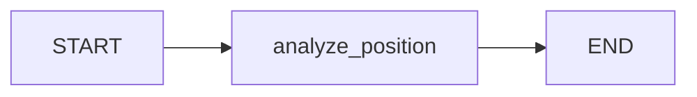

# Position and move coach

A standalone async LangGraph workflow using the OpenAI Responses API with `gpt-6-astra` (default, `reasoning.effort="medium"`) or `gpt-6.1-terra` (`reasoning.effort="medium"`). The replay screen calls it through `POST /api/coach/analyze` when Run coach is pressed. The Python interface, CLI, and LangSmith Studio use the same graph definition.



Input is `fen`, optional `played_move` in UCI, and optional `previous_move` containing the preceding FEN (`fen`) and opponent move (`uci`). The backend derives SAN and validates that the move leads to the selected position. Both optional fields are request-scoped in Studio. The only active node, `analyze_position`, returns one combined coaching card. The former `evaluate_move` adapter and prompt remain in the repository for future use, but the node is absent from the compiled graph and is never called by the app, CLI, or Studio. Each run makes one Responses request. State retains `position_analysis` and played-move `stockfish` evidence; `move_analysis` is always null and old checkpoint values are cleared.

## Flow

1. Validate the FEN, optional recorded move and previous-move context before engine work or model calls; derive the canonical board and SAN using python-chess.
2. Run an independent top-five Stockfish search with native WDL, evaluations, PVs, outlook, and deterministic position classification. This initial search does not depend on the played move.
3. Compute sharpness from all five lines, then grade candidates against the best move with the same CP/mate classifier used for player severity. Supply the first three ranked moves graded **best**, **excellent**, or **good** (strictly less than 5 percentage points of CP-derived winning-chances loss for ordinary CP scores). Uncertain candidates are excluded. Keep all five raw lines internally.
4. Reuse a played move already in that search. Otherwise evaluate only that move from the same pre-move root and completed search depth. If reliable scores put this separately searched move above the original best (including contradictory mate outcomes), verify the original five candidates plus the played move together in one restricted MultiPV search. Accept only a complete, exact batch at a common depth containing every requested root. Replace the ranked top five and played-move scores together; refresh position metrics, approved candidates, and coaching from that same batch. The played move can still finish sixth and receive an error grade. Grade the player with the Lichess logistic centipawn rule described below. Depth mismatches, missing scores, and bounded scores remain uncertain; engine failures stop before the model call. Existing saved analyses retain their evidence until the game is reanalysed.
5. Send `system_prompt.md` and a compact text message containing side to move, the opponent's previous move when available, FEN/ASCII board, decision mode, approved UCI/evaluation/SAN-PV rows, and the original move with severity. Full WDL, formulas, metadata and duplicate candidate lists stay out of the LLM input. Player-specific information may affect `move_evaluation` and the final comparison paragraph in `position_explanation`; the overview and candidate explanations remain independent.
6. Validate the five-field structured answer, including inline move references, and save only a complete successful result. Usage and response IDs describe this single call. The CLI/export text renders move tokens as SAN, with no appended second response.

An optional ASCII board must match the FEN, either as the coordinate-labeled output of `CoachPosition.from_fen(fen).ascii_board` or the plain eight rows from `str(chess.Board(fen))`. Neither the full PGN nor the game result is sent to the model.

## Structured coaching

The response contains exactly `position_overview`, `position_explanation`, `candidate_moves`, and `move_evaluation`. Positional objectives are returned within the mistake classification, with no separate decision-context field. The overview is a 20–40 word hint shown in the exercise card before an attempt and after completion. It contains no move references or solution. After **View review**, `position_explanation` contains the 60–100 word position paragraph followed, when a player move exists, by a blank line and a 1–2 sentence comparison paragraph. Its `[[uci]]` tokens render as clickable SAN, and must name a selected candidate or the original played move. Every selected candidate is referenced, and the final paragraph references the player's move even when it is also a candidate. Good moves receive positive comparisons and uncertain assessments are acknowledged. Candidate reasons and player-move explanations may contain bracketed SAN PV sequences; the overview cannot contain clickable tokens. Both paragraphs share the same embedded-move interaction; no separate player-move row is shown. Older inline reviews without a player reference get a neutral embedded link so their saved details remain accessible.

Each candidate has `uci` and `reason`. Returned candidates must exactly match every supplied UCI in the supplied order; the model cannot add, omit, or reorder them. Nonterminal positions with an approved pool have one to three moves; terminal positions or an empty approved pool require an empty array. Candidate reasons contain approximately 30–60 words and remain hidden until the move is selected. The original move opens its assessment; when it is also a candidate, the same record retains both its candidate reason and any separate assessment. Saved candidates with the retired `highlight_squares` field remain readable; new model output forbids that field. Word counts are guidance. The model cannot change the Stockfish classification or assign its own quality labels.

The API derives `move_lines` from existing engine PVs, validating every move and computing SAN and board positions locally. Within `candidate_moves[].reason` and `move_evaluation.explanation`, a short contiguous SAN excerpt such as `[[...Nxe4 Qxe4 Be6]]` renders as one clickable variation. The frontend matches it to saved PV positions, preferring the selected move's line and leaving missing or ambiguous matches as plain text. Clicking starts at the excerpt's starting position and automatically plays one ply per second, then holds the final position. Back to game restores the original game position; Replay restarts the excerpt. Navigation, another move selection, or a changed response cancels playback. The full engine continuation and comparison button are omitted. Selecting the player's embedded move still shows its severity and saved error classification. Older explanations without brackets remain readable; regeneration is required to add the new links.

`move_evaluation` contains only required nullable `explanation` and `mistake_classification` fields. A null explanation is required exactly when the played move is a supplied candidate graded best, excellent, or good; the UI reuses its candidate reason. Otherwise the explanation must be nonempty. With no recorded move, explain that no move is available and return null classification. `plan_alignment` and model-generated `better_candidate_uci` are retired; historical fields are ignored on read. The API retains a top-level `better_candidate_uci` for compatibility only when a selected candidate meets the existing CP/mate improvement threshold against a recorded error.

The LLM's `mistake_classification` is null or an object containing exactly `category` and `subcategory`. Categories are `tactical_miss`, `tactical_allowed`, and `positional`. Either tactical category requires `hanging_piece`, `fork`, `pin_skewer`, or `discovered_attack`; the prompt requires the closest match when no motif fits exactly. `positional` requires Attack, Defend, Improve, or Convert: the dominant need of the pre-move position, assessed independently of what the played move attempts. A recorded move graded inaccuracy, mistake, or blunder requires a classification object. Best, Excellent, and Good moves, uncertain quality, and absent moves require null.

For the API and lesson display, the backend preserves the model category and subcategory and derives `best_move_piece`, `played_piece`, and `same_piece` from the original board and Stockfish's rank-1 move. `same_piece` compares origin squares, so two different knights do not match. Castling identifies the king and promotion identifies the original pawn. Every new positional record requires all three fields; missing reliable move evidence fails the review before saving. Lessons groups positional errors by the objective in `subcategory`; piece facts never replace that label. Classification remains internal to lesson analytics and is not displayed as a move-detail section. Piece metadata is not part of the model output schema. Older piece-grouped positional records remain readable without invented objectives. Historical objectives are migrated when available; reviews without an objective remain unclassified in Lessons until re-coached.

Classification still requires backend severity `inaccuracy`, `mistake`, or `blunder`; candidates and played moves now share the same severity policy. The LLM output has four top-level fields; the single-node graph is unchanged.

New passes save `coach_contract_version: 7`, `classification_version: 3`, sharpness version, and previous-move context. Version 7 adds nullable decision context. `analysis_jobs.coach_version` tracks the contract so resuming an older job can refresh coaching without rerunning completed engine searches. The raw original JSON is retained before normalization, and game-move columns preserve the original `other` taxonomy. Opening a page never regenerates reviews.

Game-linked feedback belongs to `game_moves.move_id`, with prior-move context and engine evidence identity in coach metadata. `GET /api/coach/feedback` accepts `game_id` and `ply` together to resolve that context. Standalone FEN feedback uses `coach_feedback` and cannot attach itself to an imported game. A successful game-linked rerun replaces the current response; a failed run preserves it.

### Player-move severity

This policy also determines candidate approval and remains independent of position sharpness. From the player's perspective, clamp CP to [-1000, 1000] and compute `W(cp) = 100 / (1 + exp(-0.00368208 * cp))`. Compare best and played moves at the same root and depth using `loss = W(best_cp) - W(played_cp)`. A raw CP score tied with the best move is **Best**. Otherwise, loss below 2.5 pp is **Excellent**, [2.5, 5) **Good**, [5, 10) **Inaccuracy**, [10, 15) **Mistake**, and >=15 **Blunder**. A zero loss caused only by the CP cap is Excellent, not Best. Best, Excellent, and Good all qualify for candidate selection and accepted practice answers. Do not round before classification. Native WDL is not an input to player severity; missed opportunities use the same thresholds. Severity does not establish a tactical or positional cause.

Forced mates follow the separate [Lichess Advice rules](https://github.com/lichess-org/lila/blob/master/modules/tree/src/main/Advice.scala): allowing mate is a blunder, reduced to a mistake when the prior CP is below -700 or an inaccuracy below -999; losing a forced mate is a blunder, reduced to a mistake when the resulting CP exceeds 700 or an inaccuracy above 999. Keeping a forced mate, or remaining in an already forced loss, gets no error annotation: an exact raw mate-score tie is Best, otherwise Good. Mate distance changes alone are not penalized. Mate comparisons have null `winning_chances_loss_pp`, never invented CP values. The curve is documented in [scalachess eval.scala](https://github.com/lichess-org/scalachess/blob/master/core/src/main/scala/eval.scala).

Saved HTTP responses reclassify both players' stored scores and library/analysis counts on read, without engine work, model calls, or database writes. Game accuracy remains unchanged. Stored prose and position evidence are preserved; rerun the coach to regenerate an explanation under the new severity policy.

Game-linked output is stored in the explicit `coach_*` columns on `game_moves`, with exact original JSON in `coach_output_raw`. Standalone responses retain the `position_analysis`/`stockfish` supporting layout. HTTP adapters expose the existing `teaching`, `position_evidence`, `stockfish`, and derived SAN/PV fields. Direct game-linked coaching reuses saved engine evidence; if evidence is missing, phases 2.0/2.5 are persisted before the paid model request. See [the storage contract](../../docs/storage.md).

Candidate selection pauses autoplay, animates the current move back to the decision position, then animates the chosen move and holds its resulting position. No candidate arrows or square highlights are drawn. The API derives `candidate_positions` locally from legal UCI moves, including older reviews without PVs and engine-only reviews. Selecting another move replaces the preview; navigation and new responses cancel it. Reduced motion preserves the two board states without spatial animation. Reading or selecting saved feedback never triggers engine or model work.

## Web endpoint

Both request modes accept optional `model`: `gpt-6-astra` (default) or `gpt-6.1-terra`. The endpoint validates this allowlist before starting work and passes a fresh `CoachSettings` to the existing coach factory. Its Responses adapter uses that model for the single active LangGraph node; there is no alternate API path or mutable global model. The same credentials, timeout, output budget, prompts, and engine settings apply. Model-access errors identify the requested model.

`POST /api/coach/analyze` accepts either `{ "game_id": "<saved game ID>", "ply": 0 }` for a recorded-move review, or `{ "fen": "<complete selected-position FEN>" }` for position-only coaching. `ply` counts half-moves already played; the next PGN move is reviewed. At the final recorded position, the game request runs the same node without player-move evidence. Mixed modes and extra fields (including student questions) are rejected. The server derives the FEN/ASCII and played move and keeps prompts and credentials out of the browser. Only a complete successful run is saved; the response includes `fen`, nullable `played_move`, combined `text`, `model`, `response_id`, and `created_at`.

`GET /api/coach/feedback?fen=<URL-encoded FEN>&played_move=e2e4` returns the latest history-free answer for that exact FEN plus move or `null`; add `game_id` and `ply` to select a game-specific context. Omitting the move selects position-only coaching. Game detail `coach_responses` are keyed by replay ply as a string; each selects the matching FEN, move and previous-move context, with legacy position-only feedback as a fallback. The table retains all successful generations and generation metadata and engine evidence. Schema upgrades add columns without deleting existing answers. Reruns append rows; failed generations leave previous feedback untouched. Database failure returns 503 and never claims an unsaved answer was saved. Python/CLI/Studio calls remain independent of database storage.

The backend allows one active coach request per application process, returning 409 for overlapping requests. Invalid positions return 422, configuration/authentication problems 503, provider limits 429, timeouts 504, and other upstream failures 502. Provider error bodies are not exposed. Requests are not automatically retried.

The UI pauses autoplay when Run coach is pressed and shows progress. Moving to another position displays that position's saved answer; refreshing or reopening the replay restores it from PostgreSQL. The previous answer remains visible during a rerun and survives a failed generation. Student questions remain local drafts and are never sent. Leaving the replay aborts the browser request; it does not guarantee cancellation of a generation already running at OpenAI. A completed server request is still saved independently of the browser connection.

## Files

- `system_prompt.md`: the user's supplied engine-informed teaching prompt. The request's position context describes unclassified and terminal edge cases.
- `move_prompt.md`: the disconnected legacy move-review prompt.
- `move_quality.py`: selection of up to three best, excellent, or good candidates using the shared severity policy, plus played-root engine search.
- `player_move_quality.py`: independent player severity, mate handling, and saved-label recalculation.
- `teaching.py`: strict output schema, legal-move validation, SAN labels, and readable fallback rendering.
- `position.py`: FEN validation, ASCII rendering, and the position message.
- `settings.py`: supported models, default model, reasoning effort per model, and runtime limits.
- `graph.py`: input/state schemas, single-node routing, and Studio export.
- `responses.py`: request construction, traced async SDK adapter, and response handling.
- `service.py`: compatible Python interface that invokes the graph.
- `routes.py`: position and move-review HTTP endpoint, concurrency guard, and safe error mapping.
- `__main__.py`: standalone command-line entry point and dry-run preview.

## Use from Python

Set `OPENAI_API_KEY` in the backend process environment, then call:

```python
from backend.coach import open_coach

async def analyze_selected_position(fen: str, played_move: str | None = None):
    async with open_coach() as coach:
        analysis = await coach.analyze(fen, played_move=played_move)
        return analysis.text
```

The context manager owns and closes the SDK client. It can be kept open for multiple calls. To integrate with a future application lifespan or a test transport, construct `Coach(existing_async_openai_client)` instead; the caller then owns the client.

For Terra, pass `CoachSettings.from_env(model="gpt-6.1-terra")` to `open_coach(settings)` or `Coach(existing_async_openai_client, settings)`. A settings instance belongs to that coach and applies to the single call. The CLI and standalone Studio graph continue to default to Astra. The UI remembers its selection in browser storage and disables it while a run is pending. Switching the selection does not fetch or generate another answer: the latest successful answer for the position/move remains visible with its actual model, and a subsequent successful run appends to the existing feedback history.

`coach.graph` exposes the compiled graph for streaming/debugging. `coach.analyze(fen, config={"tags": ["replay"], "metadata": {"game_id": "..."}})` accepts optional LangGraph run configuration; keep credentials out of metadata and graph state.

## LangSmith tracing

The Responses client uses LangSmith's `wrap_openai`. When tracing is enabled, a successful run has this hierarchy:

```text
chess_coach
  analyze_position
    OpenAI Responses (LLM request, output, token usage)
```

Graph/node failures and provider failures are captured at their respective levels. Set these values in the ignored project `.env` to send traces:

```dotenv
LANGSMITH_TRACING=true
LANGSMITH_API_KEY=<your LangSmith API key>
LANGSMITH_PROJECT=chess-coach
LANGSMITH_ENDPOINT=https://api.smith.langchain.com
```

Use your LangSmith region's endpoint if different. Set `LANGSMITH_WORKSPACE_ID` if your key is linked to multiple workspaces. Restart the backend or Studio server after changing these values. For Docker, run `docker compose up -d` after editing `.env`; Compose applies the same coach and tracing settings to both `app` and `studio`. Use `docker compose up --build -d` when code or dependencies have also changed. A plain container restart does not reread Compose's `.env` settings.

For an agent-based LangSmith workspace, first [connect the agent and retrieve its Local environment's `tracer_session_name`](https://docs.langchain.com/langsmith/create-an-agent#configure-integrations-that-require-a-project-name). Use that compatibility value for `LANGSMITH_PROJECT` instead of `chess-coach`.

The example configuration defaults to `LANGSMITH_TRACING=false`, so the coach and game library work without LangSmith credentials. With tracing enabled, prompts (including the selected position), answers, timing, errors, and usage are sent to LangSmith. OpenAI's `store=False` setting does not disable LangSmith trace storage.

## Run in LangSmith Studio

### Docker (default)

The ordinary app startup command also starts the local Agent Server:

```sh
docker compose up --build -d
```

`app` and `studio` run separate processes from the same image. That image includes the Studio CLI, runtime dependencies, `langgraph.json`, and Stockfish. Compose supplies credentials from `.env` at runtime; `.env` is excluded from the image. No local Python installation, `.venv`, or separate Studio command is needed. The Studio service starts independently of PostgreSQL and publishes only loopback port 2024 (configurable with `STUDIO_PORT`). It has its own `/ok` health check and saves development sessions under `/app/.langgraph_api` in the `studio-data` named volume. Ordinary restarts and `docker compose down` keep that data; `docker compose down -v` deletes it along with the app's named volumes.

Both services use the code built into the image. After source or dependency edits, rerun `docker compose up --build -d`. Inspect startup errors with `docker compose logs -f studio`. The container runs with browser auto-opening and source watching disabled; open the Studio link below in your host browser.

`langgraph.json` exports `backend.coach.graph:graph` as `chess_coach`. Graph loading and inspection require no OpenAI key; running a valid position requires `OPENAI_API_KEY`.

Open [Studio connected to the local server](https://smith.langchain.com/studio/?baseUrl=http://127.0.0.1:2024), select **chess_coach**, and submit:

```json
{
  "fen": "rnbqkbnr/pppppppp/8/8/8/8/PPPPPPPP/RNBQKBNR w KQkq - 0 1",
  "played_move": "e2e4"
}
```

If `STUDIO_PORT` differs from 2024, change the port in the link's `baseUrl`. Use graph mode to inspect the active node, inputs, outputs, and state. This workflow does not expose a chat/messages interface. Every run makes one paid Responses call, with or without `played_move`. No automatic retries are made. Agent Server manages Studio threads/checkpoints. Each new invocation clears old move-review output; the optional move input is consumed for that invocation only, including when a prior run failed.

The existing FastAPI app executes the graph directly; it does not need this second server. Both entry points emit LangSmith traces when enabled, but app requests do not create Studio threads. Studio's server is a separate development surface and does not share FastAPI's single-request concurrency guard.

### Local Python (optional)

To develop with live source reloading outside Docker, stop the Docker Studio service first with `docker compose stop studio` to free port 2024, then run from the repository root on Windows:

```powershell
.\.venv\Scripts\python -m pip install -r backend\requirements-dev.txt
$env:PYTHONUTF8 = "1"
.\.venv\Scripts\langgraph dev --host 127.0.0.1 --port 2024
```

The UTF-8 setting prevents the CLI's Unicode banner from failing in Windows terminals/pipes. This mode reads `.env` directly and stores development data in the ignored local `.langgraph_api/` directory. It uses a local Stockfish installation for the coaching node.

## Move review and engine evidence

The active node uses `position_classification.py` and `move_quality.py`. These existing preparation helpers remain available independently:

- `move_review.py`: `MoveReview.from_game(pgn, ply)` pairs the current replay position with the next recorded move, validates legality, derives ASCII/SAN, and provides a FEN-plus-UCI `review_key`. `from_fen(fen, played_move)` accepts a standalone pre-move position and UCI move. The final recorded position has no move to review.
- `stockfish.py`: `analyze_move(review)` runs local Stockfish and returns JSON-compatible evidence. It requests up to eight root candidates and performs an additional root-restricted search only if the played move is missing. All scores use the reviewed side's perspective; `score.cp` is in centipawns and `score.mate` in signed moves to mate (one is null). `score.bound` distinguishes exact search scores from lower/upper bounds. These are finite-depth engine estimates, not proofs of move quality. Each candidate includes UCI/SAN, legal principal variations, and actual depth. The two searches use the same depth/time caps but can reach different depths.
- `preparation_routes.py`: `POST /api/coach/prepare-move` with `{ "game_id": "...", "ply": 0 }` derives trusted inputs from the database's PGN, runs the engine off the event loop, and rejects concurrent engine work with 409. Missing games return 404; invalid positions or missing next moves 422; missing engine/configuration 503; engine deadlines 504; incomplete engine evidence 502. It makes no model calls and does not persist feedback.

Stockfish 19 is installed and checksum-verified during the Docker build. Local Windows development can run `python scripts/install_stockfish.py` from the repository root; the resulting `.tools/stockfish` directory is ignored by Git and Docker. An existing installation can instead be selected with `STOCKFISH_PATH`. Depth, seconds per search, threads, and hash MB default to 18, 10, 2, and 128 and are configurable in `.env.example`. Each analysis owns and closes its engine process. The engine receives the FEN only, without earlier repetition history. A local CLI preview is available through `python -m backend.coach.stockfish --fen "..." --move e2e4`; it loads `.env` and prints the complete preparation JSON without OpenAI or PostgreSQL.

The replay invokes the complete coaching graph; the separate preparation endpoint remains useful for inspecting move-review engine inputs without a model call. The coaching node uses an independent top-five search and, only when needed, one restricted search for the played move. The legacy top-eight preparation endpoint is not part of the active graph.

Keep clients/settings outside graph state and create any needed clients lazily. Do not hard-code a checkpointer in the exported graph: Studio supplies one, while direct application calls currently remain independent. A new FEN in a reused Studio thread generates a fresh board and does not send old analysis to OpenAI.

## Standalone position classification

`position_classification.py` collects exact common-depth MultiPV-5 evidence; `sharpness.py` computes the shared deterministic metric without model calls or database writes. Both `classify_position(fen, settings=None)` and `analyze_position(fen, settings=None)` use this five-move rule:

1. Use the original side-to-move perspective. Clamp all five finite scores to ±1000 cp (±10 pawns); map winning/losing mates to ±1000 cp for sharpness only. Preserve the original CP/mate scores and engine ranking for all other consumers.
2. Sort the capped scores and calculate `D = sum(w[i] * (C[i] - C[i+1]))`, with `w[i] = exp(-i) / sum(exp(-j) for j in range(4))` (λ=1).
3. Normalize to `S = 100 * min(1, log1p(D/10) / log1p(687.68/10))`. D and a=10 are in centipawns. The cutoff is the fixed empirical anchor from the calibration collection; scores at or above it tie at 100.
4. Assign the tag using the unrounded score:

| Score | Classification |
|---|---|
| 0 ≤ S ≤ 20 | Forgiving |
| 20 < S ≤ 40 | Flexible |
| 40 < S ≤ 60 | Selective |
| 60 < S ≤ 80 | Demanding |
| 80 < S ≤ 100 | Critical |

```python
from backend.coach.position_classification import classify_position

result = classify_position(fen)
print(result["classification"], result["sharpness"]["raw_cp"], result["sharpness"]["score"])
```

The result includes `sharpness.version`, raw D, normalized score, cap, a, cutoff, weights, and capped scores. `classification` is the display name; `decision_classification` is its lowercase key. `delta_cp` and `delta_e_pp` remain descriptive best-versus-second diagnostics and do not determine the tag. WDL remains available internally for outlook and historical evidence; teaching candidates use the shared CP/mate severity policy. The original engine ranking and native mate distances are preserved.

Both APIs accept a complete six-field FEN and optional `StockfishSettings`, otherwise using `STOCKFISH_*` settings. They are blocking; async callers use a worker thread. The standalone classifier skips engine search when fewer than five legal moves exist. The coaching analyzer still evaluates the available one to four moves for teaching, while leaving sharpness null. Terminal positions never launch an engine. Reasons are `terminal_position`, `single_legal_move`, and `fewer_than_five_legal_moves`. Incomplete or invalid saved five-move evidence becomes `insufficient_engine_evidence`; it is never padded.

Search collection retains the latest complete, exact batch at a common depth and rejects duplicate/illegal moves, mixed depths, bounds, invalid WDL, and inconsistent orderings. Its deadline is the configured search time plus five seconds, with bounded initialization and one retry when no valid batch exists. FEN-only analysis cannot recover earlier repetition history. Production uses its existing depth/time budget; the experimental histogram used 400,000 nodes, so individual scores and tags can differ with search depth.

### Saved evidence and coaching versions

New coaching saves `sharpness_version: 2` separately from mistake `classification_version: 3` in the existing JSONB. Sharpness version 2 lowers the cap from ±2000 to ±1000 cp; weights, normalization, and tag thresholds are unchanged. API responses expose `sharpness_current` separately. Complete saved position evidence is rescored on read, including game-analysis results, without changing the stored engine evidence or making model requests. The prior explanation is not rewritten; the UI identifies coaching generated under earlier position labels, including sharpness version 1. Old incomplete saves remain unclassified until a new analysis. Cached evidence is also refreshed before new coaching; incomplete old evidence triggers the normal position search.

This update does not invalidate lesson categories or automatically regenerate completed coaching jobs. Users can refresh an earlier explanation with Run coach. The five prompt modes describe evaluation sensitivity and never imply human difficulty, a guaranteed outcome change, or that every legal move is safe. Candidate approval and player-move severity use the same CP/mate policy.

Run from the repository root:
```powershell
.\.venv\Scripts\python -m backend.coach.position_classification --fen "rnbqkbnr/pppppppp/8/8/8/8/PPPPPPPP/RNBQKBNR w KQkq - 0 1"
```

It prints JSON and exits nonzero on invalid input, unavailable engine, timeout, or incomplete evidence. After rebuilding Docker, the same module is available via `docker compose run --rm --no-deps app python -m backend.coach.position_classification --fen "..."`.

## Run without the UI

The independent Lichess motif classification is disabled. Recorded-move analysis grades moves without creating `stockfish.tactic_classification` or running motif-related Stockfish extensions. Older saved classifications remain readable as data but are hidden in the UI and excluded from the model prompt. Coach classifications and Lessons are unaffected. See [retained detector source and upstream licence](../tactics/README.md).

From the repository root, preview the first-pass request without credentials or network access:

```powershell
.\.venv\Scripts\python -m backend.coach --fen "rnbqkbnr/pppppppp/8/8/8/8/PPPPPPPP/RNBQKBNR w KQkq - 0 1" --dry-run
```

To make real, billable requests, set `OPENAI_API_KEY` in your local environment and omit `--dry-run`. Add `--previous-fen "..." --previous-move e7e5` to include validated previous-move context. Add `--move e2e4` to include move feedback in the same call, or omit it for position-only coaching. Add `--ascii-file path/to/board.txt` to validate an existing ASCII representation alongside the FEN. Dry runs validate the optional move and run local Stockfish to preview the complete first request; they make no OpenAI calls. The CLI prints the combined answer to stdout; errors go to stderr with a nonzero exit status.

Docker Compose passes `OPENAI_API_KEY`, `COACH_MAX_OUTPUT_TOKENS`, and `COACH_TIMEOUT_SECONDS` from the shell or the project's ignored `.env` file. After rebuilding the image, the same command can be run in a one-off container:

```powershell
docker compose run --rm --no-deps app python -m backend.coach --fen "rnbqkbnr/pppppppp/8/8/8/8/PPPPPPPP/RNBQKBNR w KQkq - 0 1" --dry-run
```

The FastAPI application loads the project `.env` at startup without overriding explicit process environment variables. The standalone CLI reads environment variables only; it does not automatically load `.env`. The game library starts normally without an OpenAI key.

## Limits and failures

- Output budget defaults to 32,768 tokens per model call, including internal reasoning and visible output. `COACH_MAX_OUTPUT_TOKENS` overrides it.
- Timeout defaults to 600 seconds per model call; `COACH_TIMEOUT_SECONDS` overrides it. Engine preparation has its own bounded search deadlines.
- Automatic retries are disabled to avoid another paid generation after an ambiguous timeout. The caller can explicitly retry.
- `store=False` requests that the response not be stored for later API retrieval. This is not a claim of zero data retention.
- Invalid FEN or mismatched ASCII raises `InvalidPositionError` before any API call.
- Missing credentials or invalid settings raises `CoachConfigurationError`.
- Incomplete, failed, refused, or empty responses raise `CoachResponseError`, with the response ID. Partial output is never presented as completed coaching.
- SDK connection, timeout, authentication, and quota errors propagate to Python callers; the CLI converts these to readable errors.

Tests use the real SDK with an in-memory HTTP transport. They do not call OpenAI or establish model access or chess-answer quality.

Graph tests additionally cover Studio import/schema, serialized output, client cleanup, repeated positions on a checkpointed thread, and nested success/error traces through a local LangSmith recorder. They do not establish live LangSmith ingestion.

## Official references

- [Stockfish 19 release and platform downloads](https://github.com/official-stockfish/Stockfish/releases/tag/sf_19)
- [python-chess engine analysis, MultiPV, and score perspectives](https://python-chess.readthedocs.io/en/latest/engine.html)
- [GPT-6 Astra and supported reasoning efforts](https://developers.openai.com/api/docs/models/gpt-6-astra)
- [Responses API request schema](https://developers.openai.com/api/reference/resources/responses/methods/create)
- [Reasoning model usage and token budgets](https://developers.openai.com/api/docs/guides/reasoning)
- [LangGraph graph API](https://docs.langchain.com/oss/python/langgraph/graph-api)
- [LangSmith OpenAI tracing](https://docs.langchain.com/langsmith/trace-openai)
- [Local Agent Server and Studio](https://docs.langchain.com/langsmith/local-dev-testing)
