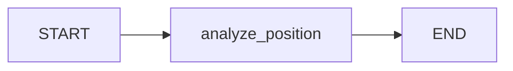

# Position and move coach

A standalone async LangGraph workflow using the OpenAI Responses API with `gpt-6-astra` (default, `reasoning.effort="medium"`) or `gpt-6.1-terra` (`reasoning.effort="medium"`). The replay screen calls it through `POST /api/coach/analyze` when Run coach is pressed. The Python interface, CLI, and LangSmith Studio use the same graph definition.



Input is `fen` plus optional `played_move` in UCI. The only active node, `analyze_position`, returns one combined coaching card. The former `evaluate_move` adapter and prompt remain in the repository for future use, but the node is absent from the compiled graph and is never called by the app, CLI, or Studio. Each run makes one Responses request. State retains `position_analysis` and played-move `stockfish` evidence; `move_analysis` is always null and old checkpoint values are cleared.

## Flow

1. Validate the FEN and optional move before engine work or model calls; derive the canonical board and SAN using python-chess.
2. Run an independent top-five Stockfish search with native WDL, evaluations, PVs, outlook, and deterministic position classification. The played move never affects this search, ranking, or approved pool.
3. Approve candidates with expected-score loss at most **5 percentage points** from the best move. Keep all five lines available for comparison. This move-quality policy is separate from the unchanged Flexible/Clear preference/Critical classifier. Large centipawn gaps in winning positions do not alone make alternatives unacceptable.
4. Reuse a played move already in that search. Otherwise evaluate only that move from the same pre-move root and completed search depth. Grade the player with the Lichess logistic centipawn rule described below. Depth mismatches, missing scores, bounded scores, or contradictory ordering yield uncertain quality. Engine failures stop before the model call.
5. Send the supplied `system_prompt.md`, position evidence with `decision_mode`, and separately labeled player-move evidence through the same Responses API. The prompt reserves player-specific information for `move_evaluation`; position teaching and candidate selection must remain independent. This is a prompt constraint within one generation, not a guarantee of identical prose across separate model runs.
6. Validate the four-field structured answer and save only a complete successful result. Usage and response IDs describe this single call. The CLI/export text is a readable rendering of the same answer, with no appended second response.

An optional ASCII board must match the FEN, either as the coordinate-labeled output of `CoachPosition.from_fen(fen).ascii_board` or the plain eight rows from `str(chess.Board(fen))`. Neither the full PGN nor the game result is sent to the model.

## Structured coaching

The response contains exactly `positional_thesis`, `needs_of_position`, `candidate_moves`, and `move_evaluation`. Each candidate has `uci`, `reason`, and exactly two distinct `highlight_squares`. Nonterminal positions require one to three legal, distinct, approved moves; terminal positions require an empty array. Word counts are guidance. The model cannot change the Stockfish classification or assign its own quality labels.

`move_evaluation` contains `plan_alignment`, nullable `explanation`, nullable `better_candidate_uci`, and nullable `mistake_classification`. Null explanations require a `good`, aligned played move already in the recommendations, allowing the UI to reuse its reason. A better-move reference requires a player error and a selected candidate improving logistic winning chances by at least 5 percentage points, or a stronger result under the mate-transition policy. Missing or conflicting quality evidence cannot produce positive indicators. With no recorded move, return an unclear alignment, an explicit no-move explanation, and null better candidate and mistake classification.

`mistake_classification` is either null or an object containing exactly `category` and `subcategory`. Tactical subcategories are `hanging_piece`, `fork`, and `discovered_attack`; positional subcategories are `pawn_structure`, `piece_play`, `defending`, and `attacking`. Either category permits a null subcategory. A classification requires a recorded move with backend severity `inaccuracy`, `mistake`, or `blunder`; an error does not require a classification when the cause is unsupported. The prompt's `severity` refers to the existing player evidence `move_quality.status`, without changing inputs or either engine policy. The UI shows the supplied category and non-null subcategory as compact tags inside the player's move row. Both fields persist inside `position_analysis.structured.move_evaluation` and return in saved feedback; older reviews with no classification load as null. No schema migration or second model call is needed.

### Player-move severity

This policy is independent of the unchanged position classifier and WDL-based candidate approval. From the player's perspective, clamp CP to [-1000, 1000] and compute `W(cp) = 100 / (1 + exp(-0.00368208 * cp))`. Compare best and played moves at the same root and depth using `loss = W(best_cp) - W(played_cp)`. Loss below 5 pp is **Good**, [5, 10) **Inaccuracy**, [10, 15) **Mistake**, and >=15 **Blunder**. Do not round before classification. Native WDL is not an input to player severity; missed opportunities use the same thresholds. Severity does not establish a tactical or positional cause.

Forced mates follow the separate [Lichess Advice rules](https://github.com/lichess-org/lila/blob/master/modules/tree/src/main/Advice.scala): allowing mate is a blunder, reduced to a mistake when the prior CP is below -700 or an inaccuracy below -999; losing a forced mate is a blunder, reduced to a mistake when the resulting CP exceeds 700 or an inaccuracy above 999. Keeping a forced mate, or remaining in an already forced loss, gets no error annotation (shown as Good). Mate distance changes alone are not penalized. Mate comparisons have null `winning_chances_loss_pp`, never invented CP values. The curve is documented in [scalachess eval.scala](https://github.com/lichess-org/scalachess/blob/master/core/src/main/scala/eval.scala).

Saved HTTP responses reclassify the player's stored scores on read, without engine work, model calls, or database writes. Stored prose and position evidence are preserved; rerun the coach to regenerate an explanation under the new severity policy.

Structured data and position evidence use the existing `position_analysis` JSONB field, while played-move evidence uses `stockfish`; no migration is needed. HTTP responses expose `teaching`, `position_evidence`, `stockfish`, and server-derived `candidate_san`. Old three-field teaching remains readable and obsolete `position_character` labels stay hidden. The combined UI displays the thesis, needs, candidates, and move feedback in one card. The played move appears once in the shared moves list with a blue Player move badge. Positive quality feedback requires acceptable engine quality. Other played moves get their own row with concise feedback and an optional link to a stronger selected candidate. Old second-node essays are not displayed; rerun coaching for the new combined feedback.

Candidate selection pauses autoplay and draws the UCI-derived arrow and two highlights on the unchanged board. Navigation and new responses clear selection; flipping transforms the overlay. Reading saved feedback never triggers engine or model work.

## Web endpoint

Both request modes accept optional `model`: `gpt-6-astra` (default) or `gpt-6.1-terra`. The endpoint validates this allowlist before starting work and passes a fresh `CoachSettings` to the existing coach factory. Its Responses adapter uses that model for the single active LangGraph node; there is no alternate API path or mutable global model. The same credentials, timeout, output budget, prompts, and engine settings apply. Model-access errors identify the requested model.

`POST /api/coach/analyze` accepts either `{ "game_id": "<saved game ID>", "ply": 0 }` for a recorded-move review, or `{ "fen": "<complete selected-position FEN>" }` for position-only coaching. `ply` counts half-moves already played; the next PGN move is reviewed. At the final recorded position, the game request runs the same node without player-move evidence. Mixed modes and extra fields (including student questions) are rejected. The server derives the FEN/ASCII and played move and keeps prompts and credentials out of the browser. Only a complete successful run is saved; the response includes `fen`, nullable `played_move`, combined `text`, `model`, `response_id`, and `created_at`.

`GET /api/coach/feedback?fen=<URL-encoded FEN>&played_move=e2e4` returns the latest answer for that exact FEN plus move or `null`. Omitting the move selects position-only coaching. Game detail `coach_responses` are keyed by replay ply as a string; each selects the correct FEN/move pair, with legacy position-only feedback as a fallback. The table retains all successful generations and generation metadata and engine evidence. Schema upgrades add columns without deleting existing answers. Reruns append rows; failed generations leave previous feedback untouched. Database failure returns 503 and never claims an unsaved answer was saved. Python/CLI/Studio calls remain independent of database storage.

The backend allows one active coach request per application process, returning 409 for overlapping requests. Invalid positions return 422, configuration/authentication problems 503, provider limits 429, timeouts 504, and other upstream failures 502. Provider error bodies are not exposed. Requests are not automatically retried.

The UI pauses autoplay when Run coach is pressed and shows progress. Moving to another position displays that position's saved answer; refreshing or reopening the replay restores it from PostgreSQL. The previous answer remains visible during a rerun and survives a failed generation. Student questions remain local drafts and are never sent. Leaving the replay aborts the browser request; it does not guarantee cancellation of a generation already running at OpenAI. A completed server request is still saved independently of the browser connection.

## Files

- `system_prompt.md`: the user's supplied engine-informed teaching prompt. The request's position context describes unclassified and terminal edge cases.
- `move_prompt.md`: the disconnected legacy move-review prompt.
- `move_quality.py`: unchanged WDL candidate approval and played-root engine search.
- `player_move_quality.py`: independent player severity, mate handling, and saved-label recalculation.
- `teaching.py`: strict output schema, legal-move validation, SAN labels, and readable fallback rendering.
- `position.py`: FEN validation, ASCII rendering, and the position message.
- `settings.py`: supported models, default model, reasoning effort per model, and runtime limits.
- `graph.py`: input/state schemas, single-node routing, and Studio export.
- `responses.py`: request construction, traced async SDK adapter, and response handling.
- `service.py`: compatible Python interface that invokes the graph.
- `routes.py`: position and move-review HTTP endpoint, concurrency guard, and safe error mapping.
- `__main__.py`: standalone command-line entry point and dry-run preview.

## Use from Python

Set `OPENAI_API_KEY` in the backend process environment, then call:

```python
from backend.coach import open_coach

async def analyze_selected_position(fen: str, played_move: str | None = None):
    async with open_coach() as coach:
        analysis = await coach.analyze(fen, played_move=played_move)
        return analysis.text
```

The context manager owns and closes the SDK client. It can be kept open for multiple calls. To integrate with a future application lifespan or a test transport, construct `Coach(existing_async_openai_client)` instead; the caller then owns the client.

For Terra, pass `CoachSettings.from_env(model="gpt-6.1-terra")` to `open_coach(settings)` or `Coach(existing_async_openai_client, settings)`. A settings instance belongs to that coach and applies to the single call. The CLI and standalone Studio graph continue to default to Astra. The UI remembers its selection in browser storage and disables it while a run is pending. Switching the selection does not fetch or generate another answer: the latest successful answer for the position/move remains visible with its actual model, and a subsequent successful run appends to the existing feedback history.

`coach.graph` exposes the compiled graph for streaming/debugging. `coach.analyze(fen, config={"tags": ["replay"], "metadata": {"game_id": "..."}})` accepts optional LangGraph run configuration; keep credentials out of metadata and graph state.

## LangSmith tracing

The Responses client uses LangSmith's `wrap_openai`. When tracing is enabled, a successful run has this hierarchy:

```text
chess_coach
  analyze_position
    OpenAI Responses (LLM request, output, token usage)
```

Graph/node failures and provider failures are captured at their respective levels. Set these values in the ignored project `.env` to send traces:

```dotenv
LANGSMITH_TRACING=true
LANGSMITH_API_KEY=<your LangSmith API key>
LANGSMITH_PROJECT=chess-coach
LANGSMITH_ENDPOINT=https://api.smith.langchain.com
```

Use your LangSmith region's endpoint if different. Set `LANGSMITH_WORKSPACE_ID` if your key is linked to multiple workspaces. Restart the backend or Studio server after changing these values. For Docker, run `docker compose up -d` after editing `.env`; Compose applies the same coach and tracing settings to both `app` and `studio`. Use `docker compose up --build -d` when code or dependencies have also changed. A plain container restart does not reread Compose's `.env` settings.

For an agent-based LangSmith workspace, first [connect the agent and retrieve its Local environment's `tracer_session_name`](https://docs.langchain.com/langsmith/create-an-agent#configure-integrations-that-require-a-project-name). Use that compatibility value for `LANGSMITH_PROJECT` instead of `chess-coach`.

The example configuration defaults to `LANGSMITH_TRACING=false`, so the coach and game library work without LangSmith credentials. With tracing enabled, prompts (including the selected position), answers, timing, errors, and usage are sent to LangSmith. OpenAI's `store=False` setting does not disable LangSmith trace storage.

## Run in LangSmith Studio

### Docker (default)

The ordinary app startup command also starts the local Agent Server:

```sh
docker compose up --build -d
```

`app` and `studio` run separate processes from the same image. That image includes the Studio CLI, runtime dependencies, `langgraph.json`, and Stockfish. Compose supplies credentials from `.env` at runtime; `.env` is excluded from the image. No local Python installation, `.venv`, or separate Studio command is needed. The Studio service starts independently of PostgreSQL and publishes only loopback port 2024 (configurable with `STUDIO_PORT`). It has its own `/ok` health check and saves development sessions under `/app/.langgraph_api` in the `studio-data` named volume. Ordinary restarts and `docker compose down` keep that data; `docker compose down -v` deletes it along with the app's named volumes.

Both services use the code built into the image. After source or dependency edits, rerun `docker compose up --build -d`. Inspect startup errors with `docker compose logs -f studio`. The container runs with browser auto-opening and source watching disabled; open the Studio link below in your host browser.

`langgraph.json` exports `backend.coach.graph:graph` as `chess_coach`. Graph loading and inspection require no OpenAI key; running a valid position requires `OPENAI_API_KEY`.

Open [Studio connected to the local server](https://smith.langchain.com/studio/?baseUrl=http://127.0.0.1:2024), select **chess_coach**, and submit:

```json
{
  "fen": "rnbqkbnr/pppppppp/8/8/8/8/PPPPPPPP/RNBQKBNR w KQkq - 0 1",
  "played_move": "e2e4"
}
```

If `STUDIO_PORT` differs from 2024, change the port in the link's `baseUrl`. Use graph mode to inspect the active node, inputs, outputs, and state. This workflow does not expose a chat/messages interface. Every run makes one paid Responses call, with or without `played_move`. No automatic retries are made. Agent Server manages Studio threads/checkpoints. Each new invocation clears old move-review output; the optional move input is consumed for that invocation only, including when a prior run failed.

The existing FastAPI app executes the graph directly; it does not need this second server. Both entry points emit LangSmith traces when enabled, but app requests do not create Studio threads. Studio's server is a separate development surface and does not share FastAPI's single-request concurrency guard.

### Local Python (optional)

To develop with live source reloading outside Docker, stop the Docker Studio service first with `docker compose stop studio` to free port 2024, then run from the repository root on Windows:

```powershell
.\.venv\Scripts\python -m pip install -r backend\requirements-dev.txt
$env:PYTHONUTF8 = "1"
.\.venv\Scripts\langgraph dev --host 127.0.0.1 --port 2024
```

The UTF-8 setting prevents the CLI's Unicode banner from failing in Windows terminals/pipes. This mode reads `.env` directly and stores development data in the ignored local `.langgraph_api/` directory. It uses a local Stockfish installation for the coaching node.

## Move review and engine evidence

The active node uses `position_classification.py` and `move_quality.py`. These existing preparation helpers remain available independently:

- `move_review.py`: `MoveReview.from_game(pgn, ply)` pairs the current replay position with the next recorded move, validates legality, derives ASCII/SAN, and provides a FEN-plus-UCI `review_key`. `from_fen(fen, played_move)` accepts a standalone pre-move position and UCI move. The final recorded position has no move to review.
- `stockfish.py`: `analyze_move(review)` runs local Stockfish and returns JSON-compatible evidence. It requests up to eight root candidates and performs an additional root-restricted search only if the played move is missing. All scores use the reviewed side's perspective; `score.cp` is in centipawns and `score.mate` in signed moves to mate (one is null). `score.bound` distinguishes exact search scores from lower/upper bounds. These are finite-depth engine estimates, not proofs of move quality. Each candidate includes UCI/SAN, legal principal variations, and actual depth. The two searches use the same depth/time caps but can reach different depths.
- `preparation_routes.py`: `POST /api/coach/prepare-move` with `{ "game_id": "...", "ply": 0 }` derives trusted inputs from the database's PGN, runs the engine off the event loop, and rejects concurrent engine work with 409. Missing games return 404; invalid positions or missing next moves 422; missing engine/configuration 503; engine deadlines 504; incomplete engine evidence 502. It makes no model calls and does not persist feedback.

Stockfish 19 is installed and checksum-verified during the Docker build. Local Windows development can run `python scripts/install_stockfish.py` from the repository root; the resulting `.tools/stockfish` directory is ignored by Git and Docker. An existing installation can instead be selected with `STOCKFISH_PATH`. Depth, seconds per search, threads, and hash MB default to 18, 10, 2, and 128 and are configurable in `.env.example`. Each analysis owns and closes its engine process. The engine receives the FEN only, without earlier repetition history. A local CLI preview is available through `python -m backend.coach.stockfish --fen "..." --move e2e4`; it loads `.env` and prints the complete preparation JSON without OpenAI or PostgreSQL.

The replay invokes the complete coaching graph; the separate preparation endpoint remains useful for inspecting move-review engine inputs without a model call. The coaching node uses an independent top-five search and, only when needed, one restricted search for the played move. The legacy top-eight preparation endpoint is not part of the active graph.

Keep clients/settings outside graph state and create any needed clients lazily. Do not hard-code a checkpointer in the exported graph: Studio supplies one, while direct application calls currently remain independent. A new FEN in a reused Studio thread generates a fresh board and does not send old analysis to OpenAI.

## Standalone position classification

`position_classification.py` implements the best-versus-second-best algorithm without OpenAI calls or database writes. Its standalone `classify_position` API retains the top-two behavior. Its `analyze_position` API requests up to five candidates and supplies the first coaching node and UI through the saved first-pass evidence. Call the standalone classifier from Python:

```python
from backend.coach.position_classification import classify_position

result = classify_position(fen)
print(result["classification"], result["delta_cp"], result["delta_e_pp"])
```

`classify_position(fen, settings=None)` accepts a complete six-field FEN and optional `StockfishSettings`; otherwise it reads the existing `STOCKFISH_*` environment settings. This is a blocking function; async callers should run it in a worker thread.

`analyze_position(fen, settings=None)` applies the same classification thresholds to the best two moves in its top-five search, and adds `decision_classification` (`flexible`, `clear_preference`, `critical`, or null), `position_outlook`, and `permitted_candidate_uci`. Every candidate includes `relative_quality.cp_loss_from_best` and `relative_quality.expected_score_loss_pp`. A single legal move is evaluated and supplied as the sole candidate with a null classification. All candidates come from the same completed depth; finite-depth results can differ from a separate MultiPV=2 run.

The classifier enables Stockfish's native `UCI_ShowWDL` output and requests `MultiPV=2`. Both centipawn scores and WDL estimates are normalized to the side to move. WDL counts are per thousand; for each candidate it calculates `E = (wins + 0.5 * draws) / 1000`. It then applies the supplied criteria exactly:

| Classification | Criteria |
| --- | --- |
| Flexible | `delta_cp <= 35` **and** `delta_e_pp <= 5` |
| Clear preference | Not Flexible, and `delta_e_pp < 20` |
| Critical | `delta_e_pp >= 20` |

`delta_cp = CP_best - CP_second`; `delta_e_pp = 100 * (E_best - E_second)` is in percentage points. Threshold comparisons use exact rational arithmetic, with no rounding before classification. The JSON-compatible result contains the normalized FEN, perspective, classification, both gaps, two ranked candidates with UCI/SAN/PV, CP or mate score, native WDL counts, probabilities, expected score, achieved depth, and engine/resource metadata.

The latest complete pair at a common depth is used, so a time-limited search ending between MultiPV lines does not compare different iterations. Missing WDL, incomplete pairs, invalid variations, duplicate moves, and inconsistent rankings raise `StockfishAnalysisError`; bound-only scores are excluded. Search collection has a deadline of the configured search time plus five seconds, and initialization/configuration each have a five-second deadline. The engine process is closed on success and failure. WDL values are Stockfish's approximate engine-self-play outcome estimates, not player-specific probabilities; see the [official UCI_ShowWDL documentation](https://official-stockfish.github.io/docs/stockfish-wiki/UCI-Protocol-and-Stockfish-Commands.html#uci_showwdl).

For terminal positions or a single legal move, the result has `classification: null` and `unclassified_reason: "terminal_position"` or `"single_legal_move"`, without starting Stockfish. Mate scores retain their mate distance and have no invented CP equivalent. If `delta_e_pp > 5`, the expected-score gap alone determines Clear preference or Critical; otherwise a comparison involving a mate score returns `classification: null`, `delta_cp: null`, and `unclassified_reason: "mate_score"`. FEN-only analysis cannot recover earlier repetition history.

Run the standalone CLI from the repository root (it loads `.env` for engine settings):

```powershell
.\.venv\Scripts\python -m backend.coach.position_classification --fen "rnbqkbnr/pppppppp/8/8/8/8/PPPPPPPP/RNBQKBNR w KQkq - 0 1"
```

It prints JSON and exits nonzero on invalid input, unavailable engine, timeout, or incomplete evidence. After rebuilding Docker, the same module is available via `docker compose run --rm --no-deps app python -m backend.coach.position_classification --fen "..."`.

## Run without the UI

From the repository root, preview the first-pass request without credentials or network access:

```powershell
.\.venv\Scripts\python -m backend.coach --fen "rnbqkbnr/pppppppp/8/8/8/8/PPPPPPPP/RNBQKBNR w KQkq - 0 1" --dry-run
```

To make real, billable requests, set `OPENAI_API_KEY` in your local environment and omit `--dry-run`. Add `--move e2e4` to include move feedback in the same call, or omit it for position-only coaching. Add `--ascii-file path/to/board.txt` to validate an existing ASCII representation alongside the FEN. Dry runs validate the optional move and run local Stockfish to preview the complete first request; they make no OpenAI calls. The CLI prints the combined answer to stdout; errors go to stderr with a nonzero exit status.

Docker Compose passes `OPENAI_API_KEY`, `COACH_MAX_OUTPUT_TOKENS`, and `COACH_TIMEOUT_SECONDS` from the shell or the project's ignored `.env` file. After rebuilding the image, the same command can be run in a one-off container:

```powershell
docker compose run --rm --no-deps app python -m backend.coach --fen "rnbqkbnr/pppppppp/8/8/8/8/PPPPPPPP/RNBQKBNR w KQkq - 0 1" --dry-run
```

The FastAPI application loads the project `.env` at startup without overriding explicit process environment variables. The standalone CLI reads environment variables only; it does not automatically load `.env`. The game library starts normally without an OpenAI key.

## Limits and failures

- Output budget defaults to 32,768 tokens per model call, including internal reasoning and visible output. `COACH_MAX_OUTPUT_TOKENS` overrides it.
- Timeout defaults to 600 seconds per model call; `COACH_TIMEOUT_SECONDS` overrides it. Engine preparation has its own bounded search deadlines.
- Automatic retries are disabled to avoid another paid generation after an ambiguous timeout. The caller can explicitly retry.
- `store=False` requests that the response not be stored for later API retrieval. This is not a claim of zero data retention.
- Invalid FEN or mismatched ASCII raises `InvalidPositionError` before any API call.
- Missing credentials or invalid settings raises `CoachConfigurationError`.
- Incomplete, failed, refused, or empty responses raise `CoachResponseError`, with the response ID. Partial output is never presented as completed coaching.
- SDK connection, timeout, authentication, and quota errors propagate to Python callers; the CLI converts these to readable errors.

Tests use the real SDK with an in-memory HTTP transport. They do not call OpenAI or establish model access or chess-answer quality.

Graph tests additionally cover Studio import/schema, serialized output, client cleanup, repeated positions on a checkpointed thread, and nested success/error traces through a local LangSmith recorder. They do not establish live LangSmith ingestion.

## Official references

- [Stockfish 19 release and platform downloads](https://github.com/official-stockfish/Stockfish/releases/tag/sf_19)
- [python-chess engine analysis, MultiPV, and score perspectives](https://python-chess.readthedocs.io/en/latest/engine.html)
- [GPT-6 Astra and supported reasoning efforts](https://developers.openai.com/api/docs/models/gpt-6-astra)
- [Responses API request schema](https://developers.openai.com/api/reference/resources/responses/methods/create)
- [Reasoning model usage and token budgets](https://developers.openai.com/api/docs/guides/reasoning)
- [LangGraph graph API](https://docs.langchain.com/oss/python/langgraph/graph-api)
- [LangSmith OpenAI tracing](https://docs.langchain.com/langsmith/trace-openai)
- [Local Agent Server and Studio](https://docs.langchain.com/langsmith/local-dev-testing)
