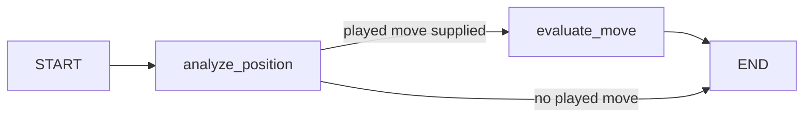

# Position and move coach

A standalone async LangGraph workflow using the OpenAI Responses API, `gpt-6-astra`, and `reasoning.effort="xhigh"`. The replay screen calls it through `POST /api/coach/analyze` when Run coach is pressed. The Python interface, CLI, and LangSmith Studio use the same graph definition.



Input is `fen` plus optional `played_move` in UCI. The board is always derived from that FEN. `analyze_position` produces the first two coaching sections; `evaluate_move` produces section 3 and appends it with a blank line. State retains separate `position_analysis`, `move_analysis`, and `stockfish` objects, plus combined `text` and total `usage`. Each pass retains its own model, response ID, and usage. The top-level response ID/model identify the final completed pass. The normalized played move is available as `move_uci` in graph output and `played_move` in `CoachAnalysis` and HTTP responses.

## Flow

1. Receive the selected position's complete FEN.
2. Validate it with python-chess and generate a coordinate-labeled ASCII board. White is always at the bottom; letter case identifies piece color.
3. Send the exact contents of `system_prompt.md` as a system message, followed by a user message containing the FEN, ASCII board, and side to move.
4. If a played move exists, run Stockfish off the event loop to obtain up to eight root candidates plus the played move when outside the eight.
5. Send `move_prompt.md` as the second call's system message, with the first response verbatim, the same FEN/ASCII board, the played move in UCI/SAN, and engine evidence as user input. Both calls use GPT-6 Astra with xhigh reasoning and `store=False`; prior output is sent explicitly rather than via a stored response ID.
6. Append the second response to the first. Without a played move, return only the first response. Invalid moves are rejected before either model call.

An optional ASCII board can also be supplied. It must match the FEN, either as the coordinate-labeled output of `CoachPosition.from_fen(fen).ascii_board` or the plain eight rows from `str(chess.Board(fen))`. Whitespace differences are accepted. The canonical board is always sent to OpenAI, preventing mismatched or flipped inputs.

The first call receives no played move or engine information. The second receives only the reviewed move and supplied engine evidence, not the full PGN, result, or game history. The module does not rewrite the generated Markdown; the two prompts specify the section structure.

## Web endpoint

`POST /api/coach/analyze` accepts either `{ "game_id": "<saved game ID>", "ply": 0 }` for a recorded-move review, or `{ "fen": "<complete selected-position FEN>" }` for position-only coaching. `ply` counts half-moves already played; the next PGN move is reviewed. At the final recorded position, the game request runs only the first pass. Mixed modes and extra fields (including student questions) are rejected. The server derives the FEN/ASCII and played move and keeps prompts and credentials out of the browser. Only a complete successful run is saved; the response includes `fen`, nullable `played_move`, combined `text`, `model`, `response_id`, and `created_at`.

`GET /api/coach/feedback?fen=<URL-encoded FEN>&played_move=e2e4` returns the latest answer for that exact FEN plus move or `null`. Omitting the move selects position-only coaching. Game detail `coach_responses` are keyed by replay ply as a string; each selects the correct FEN/move pair, with legacy position-only feedback as a fallback. The table retains all successful generations and both passes' metadata and engine evidence. Schema upgrades add columns without deleting existing answers. Reruns append rows; failed second passes leave previous feedback untouched. Database failure returns 503 and never claims an unsaved answer was saved. Python/CLI/Studio calls remain independent of database storage.

The backend allows one active coach request per application process, returning 409 for overlapping requests. Invalid positions return 422, configuration/authentication problems 503, provider limits 429, timeouts 504, and other upstream failures 502. Provider error bodies are not exposed. Requests are not automatically retried.

The UI pauses autoplay when Run coach is pressed and shows progress. Moving to another position displays that position's saved answer; refreshing or reopening the replay restores it from PostgreSQL. The previous answer remains visible during a rerun and survives a failed generation. Student questions remain local drafts and are never sent. Leaving the replay aborts the browser request; it does not guarantee cancellation of a generation already running at OpenAI. A completed server request is still saved independently of the browser connection.

## Files

- `system_prompt.md`: the user's supplied prompt, copied byte for byte.
- `move_prompt.md`: the user's supplied second-pass prompt, copied byte for byte.
- `position.py`: FEN validation, ASCII rendering, and the position message.
- `settings.py`: fixed model/reasoning settings and runtime limits.
- `graph.py`: input/state schemas, both nodes, conditional routing, and Studio export.
- `responses.py`: request construction, traced async SDK adapter, and response handling.
- `service.py`: compatible Python interface that invokes the graph.
- `routes.py`: position and move-review HTTP endpoint, concurrency guard, and safe error mapping.
- `__main__.py`: standalone command-line entry point and dry-run preview.

## Use from Python

Set `OPENAI_API_KEY` in the backend process environment, then call:

```python
from backend.coach import open_coach

async def analyze_selected_position(fen: str, played_move: str | None = None):
    async with open_coach() as coach:
        analysis = await coach.analyze(fen, played_move=played_move)
        return analysis.text
```

The context manager owns and closes the SDK client. It can be kept open for multiple calls. To integrate with a future application lifespan or a test transport, construct `Coach(existing_async_openai_client)` instead; the caller then owns the client.

`coach.graph` exposes the compiled graph for streaming/debugging. `coach.analyze(fen, config={"tags": ["replay"], "metadata": {"game_id": "..."}})` accepts optional LangGraph run configuration; keep credentials out of metadata and graph state.

## LangSmith tracing

The Responses client uses LangSmith's `wrap_openai`. When tracing is enabled, a successful run has this hierarchy:

```text
chess_coach
  analyze_position
    OpenAI Responses (LLM request, output, token usage)
  evaluate_move (when a played move exists)
    OpenAI Responses (LLM request, output, token usage)
```

Graph/node failures and provider failures are captured at their respective levels. Set these values in the ignored project `.env` to send traces:

```dotenv
LANGSMITH_TRACING=true
LANGSMITH_API_KEY=<your LangSmith API key>
LANGSMITH_PROJECT=chess-coach
LANGSMITH_ENDPOINT=https://api.smith.langchain.com
```

Use your LangSmith region's endpoint if different. Set `LANGSMITH_WORKSPACE_ID` if your key is linked to multiple workspaces. Restart the backend or Studio server after changing these values. For Docker, rebuild with `docker compose up --build -d`; Compose passes the tracing variables to the backend.

The example configuration defaults to `LANGSMITH_TRACING=false`, so the coach and game library work without LangSmith credentials. With tracing enabled, prompts (including the selected position), answers, timing, errors, and usage are sent to LangSmith. OpenAI's `store=False` setting does not disable LangSmith trace storage.

## Run in LangSmith Studio

From the repository root on Windows, install the development dependencies and start the local Agent Server:

```powershell
.\.venv\Scripts\python -m pip install -r backend\requirements-dev.txt
$env:PYTHONUTF8 = "1"
.\.venv\Scripts\langgraph dev --host 127.0.0.1 --port 2024
```

The UTF-8 setting also prevents the CLI's Unicode banner from failing in Windows terminals/pipes. `langgraph.json` exports `backend.coach.graph:graph` as `chess_coach` and loads `.env`. Graph loading and inspection require no OpenAI key; running a valid position requires `OPENAI_API_KEY`.

Open [Studio connected to the local server](https://smith.langchain.com/studio/?baseUrl=http://127.0.0.1:2024), select **chess_coach**, and submit:

```json
{
  "fen": "rnbqkbnr/pppppppp/8/8/8/8/PPPPPPPP/RNBQKBNR w KQkq - 0 1",
  "played_move": "e2e4"
}
```

Use graph mode to inspect both nodes, inputs, outputs, and state. This workflow does not expose a chat/messages interface. A run with `played_move` makes two paid Responses calls; omit it for one position-only call. No automatic retries are made. Agent Server manages Studio threads/checkpoints, with local development data in ignored `.langgraph_api/`. Each new invocation clears old move-review output; the optional move input is consumed for that invocation only, including when a prior run failed.

The existing FastAPI app executes the graph directly; it does not need this second server. Both entry points emit LangSmith traces when enabled, but app requests do not create Studio threads. Studio's server is a separate development surface and does not share FastAPI's single-request concurrency guard.

## Move review and engine evidence

The second node uses these engine helpers:

- `move_review.py`: `MoveReview.from_game(pgn, ply)` pairs the current replay position with the next recorded move, validates legality, derives ASCII/SAN, and provides a FEN-plus-UCI `review_key`. `from_fen(fen, played_move)` accepts a standalone pre-move position and UCI move. The final recorded position has no move to review.
- `stockfish.py`: `analyze_move(review)` runs local Stockfish and returns JSON-compatible evidence. It requests up to eight root candidates and performs an additional root-restricted search only if the played move is missing. All scores use the reviewed side's perspective; `score.cp` is in centipawns and `score.mate` in signed moves to mate (one is null). `score.bound` distinguishes exact search scores from lower/upper bounds. These are finite-depth engine estimates, not proofs of move quality. Each candidate includes UCI/SAN, legal principal variations, and actual depth. The two searches use the same depth/time caps but can reach different depths.
- `preparation_routes.py`: `POST /api/coach/prepare-move` with `{ "game_id": "...", "ply": 0 }` derives trusted inputs from the database's PGN, runs the engine off the event loop, and rejects concurrent engine work with 409. Missing games return 404; invalid positions or missing next moves 422; missing engine/configuration 503; engine deadlines 504; incomplete engine evidence 502. It makes no model calls and does not persist feedback.

Stockfish 19 is installed and checksum-verified during the Docker build. Local Windows development can run `python scripts/install_stockfish.py` from the repository root; the resulting `.tools/stockfish` directory is ignored by Git and Docker. An existing installation can instead be selected with `STOCKFISH_PATH`. Depth, seconds per search, threads, and hash MB default to 18, 10, 2, and 128 and are configurable in `.env.example`. Each analysis owns and closes its engine process. The engine receives the FEN only, without earlier repetition history. A local CLI preview is available through `python -m backend.coach.stockfish --fen "..." --move e2e4`; it loads `.env` and prints the complete preparation JSON without OpenAI or PostgreSQL.

The replay invokes the complete coaching graph; the separate preparation endpoint remains useful for inspecting engine inputs without a model call. The first-pass prompt and request remain position-only. The second node gets fresh engine evidence and only the current run's first response.

Keep clients/settings outside graph state and create any needed clients lazily. Do not hard-code a checkpointer in the exported graph: Studio supplies one, while direct application calls currently remain independent. A new FEN in a reused Studio thread generates a fresh board and does not send old analysis to OpenAI.

## Run without the UI

From the repository root, preview the first-pass request without credentials or network access:

```powershell
.\.venv\Scripts\python -m backend.coach --fen "rnbqkbnr/pppppppp/8/8/8/8/PPPPPPPP/RNBQKBNR w KQkq - 0 1" --dry-run
```

To make real, billable requests, set `OPENAI_API_KEY` in your local environment and omit `--dry-run`. Add `--move e2e4` to run the second pass, or omit it for position-only coaching. Add `--ascii-file path/to/board.txt` to validate an existing ASCII representation alongside the FEN. Dry runs validate the optional move but preview only the first request, without running Stockfish. The CLI prints the combined answer to stdout; errors go to stderr with a nonzero exit status.

Docker Compose passes `OPENAI_API_KEY`, `COACH_MAX_OUTPUT_TOKENS`, and `COACH_TIMEOUT_SECONDS` from the shell or the project's ignored `.env` file. After rebuilding the image, the same command can be run in a one-off container:

```powershell
docker compose run --rm --no-deps app python -m backend.coach --fen "rnbqkbnr/pppppppp/8/8/8/8/PPPPPPPP/RNBQKBNR w KQkq - 0 1" --dry-run
```

The FastAPI application loads the project `.env` at startup without overriding explicit process environment variables. The standalone CLI reads environment variables only; it does not automatically load `.env`. The game library starts normally without an OpenAI key.

## Limits and failures

- Output budget defaults to 32,768 tokens per model call, including internal reasoning and visible output. `COACH_MAX_OUTPUT_TOKENS` overrides it.
- Timeout defaults to 600 seconds per model call; `COACH_TIMEOUT_SECONDS` overrides it. A two-pass run can take longer than one call's timeout.
- Automatic retries are disabled to avoid another paid generation after an ambiguous timeout. The caller can explicitly retry.
- `store=False` requests that the response not be stored for later API retrieval. This is not a claim of zero data retention.
- Invalid FEN or mismatched ASCII raises `InvalidPositionError` before any API call.
- Missing credentials or invalid settings raises `CoachConfigurationError`.
- Incomplete, failed, refused, or empty responses raise `CoachResponseError`, with the response ID. Partial output is never presented as completed coaching.
- SDK connection, timeout, authentication, and quota errors propagate to Python callers; the CLI converts these to readable errors.

Tests use the real SDK with an in-memory HTTP transport. They do not call OpenAI or establish model access or chess-answer quality.

Graph tests additionally cover Studio import/schema, serialized output, client cleanup, repeated positions on a checkpointed thread, and nested success/error traces through a local LangSmith recorder. They do not establish live LangSmith ingestion.

## Official references

- [Stockfish 19 release and platform downloads](https://github.com/official-stockfish/Stockfish/releases/tag/sf_19)
- [python-chess engine analysis, MultiPV, and score perspectives](https://python-chess.readthedocs.io/en/latest/engine.html)
- [GPT-6 Astra and supported reasoning efforts](https://developers.openai.com/api/docs/models/gpt-6-astra)
- [Responses API request schema](https://developers.openai.com/api/reference/resources/responses/methods/create)
- [Reasoning model usage and token budgets](https://developers.openai.com/api/docs/guides/reasoning)
- [LangGraph graph API](https://docs.langchain.com/oss/python/langgraph/graph-api)
- [LangSmith OpenAI tracing](https://docs.langchain.com/langsmith/trace-openai)
- [Local Agent Server and Studio](https://docs.langchain.com/langsmith/local-dev-testing)
