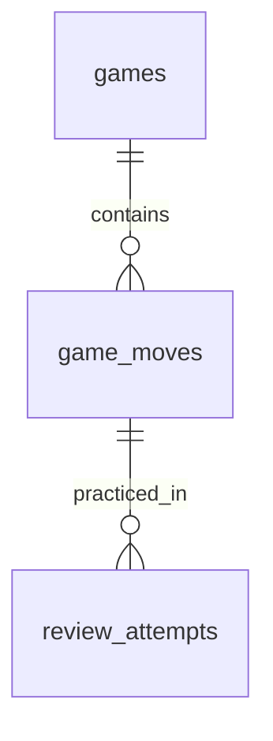

# Analytics storage contract

The complete field types, nullability, constraints and indexes are in `backend/schema.sql`.

## Phase ownership

| Phase | Trigger | Reads | Writes |
| --- | --- | --- | --- |
| 1: import | Import or account sync | Provider payload and PGN | `games` source fields and every `game_moves` source/clock/board field |
| 2.0: engine | Analyze/resume game, or explicit game-linked coaching needing evidence | Recorded pre-move position and original UCI | Per-move top-five and played CP/mate/depth/bound/PV columns, search provenance, status and final-board evidence |
| 2.5: metrics | Successful evidence persistence; complete timeline | Saved engine scores | Move quality, pre-move sharpness score/classification, both game accuracy fields |
| 3: coaching | Selected player error, or explicit game-linked coach request | Position, preceding move, approved engine moves, original move | Explanations, candidates, taxonomy, optional decision context, exact raw response, model/usage/version metadata |
| 4: practice | Legal submission or deliberate repeat review | Original `move_id` and pre-move position | Review session and ordered submissions, including the final Good move |

All schema columns exist from the start. Import creates source rows; engine and coaching enrich them. Practice creates separate session rows. Import never starts an engine or model request. Whole-game analysis evaluates both colors, completes accuracy, then coaches only the selected player's inaccuracies, mistakes and blunders. Direct coaching saves new engine evidence before contacting the model, so a model failure does not lose completed phase 2 work.

## Identities and conventions

- `games.game_id` is a stable internal identifier. Deduplicate by provider identity, falling back to source URL. Player identity and game-time ratings stay on the game.
- `game_moves.move_id` is stable across identical reimports. `(game_id, decision_ply)` is unique. The decision index starts at zero regardless of the starting full-move number or color.
- Source changes replace the recorded sequence and invalidate its downstream data atomically. Resetting analysis preserves source rows and move IDs.
- Stored engine evaluations use White's perspective. Each score populates exactly one of CP or mate. Black conversion negates scores and swaps lower/upper bounds, without changing candidate ranks. Unused candidate slots are null.
- The played move reuses a matching candidate's score, depth, bound and PV. Rank one supplies the pre-move evaluation. The final board has separate evidence on the last move; mate-in-zero retains its winner.
- Search metadata records limits, threads, hash, root scope, MultiPV, FEN-only history mode, evidence format and calculation policies. Optional comparison evidence retains original and recheck searches, also White-relative.
- Missing values remain null, including unsupported clocks and unavailable accuracy/sharpness. Uncertain means a move was graded but the evidence could not establish a reliable grade.
- `material_balance_before` is mover-relative, using 1/3/3/5/9; engine perspective does not change this convention. Game phase uses the existing sequential board-based rules.
- Timestamps are UTC-aware. PGN elapsed annotations take precedence over clock arithmetic. Supported base/increment controls use previous clock plus increment minus current clock; unknown initial clocks are not invented.

## Coaching

One current successful response belongs to each recorded move. `coach_output_raw` is the unmodified returned JSON text; queryable fields are populated after validation. Preserve raw `other` while adapting it to Positional for existing lesson displays. `coach_decision_context` is Attack, Defend, Improve, Convert or null, with no mandatory concept taxonomy.

The metadata retains model, response ID, usage, generation time, contract/classification/sharpness versions, prior-move context and the engine evidence identity. A failed or stale generation cannot erase or replace successful coaching. Game-linked reads do not borrow standalone responses from another context.

## Review sessions

`review_attempts` contains `review_id`, `move_id`, `review_number`, `created_at`, `status`, and `tried_moves`. Each ordered JSON entry contains `uci`, `quality`, and `grading_status`. It also has an operational `submission_id` for idempotent retries; this is not another analytics measure.

Every submission starts from the same original position, rather than continuing the previous trial. Only a graded Good move completes a session. Technical failures remain failed/ungraded and do not count as bad chess moves. Reopening resumes the latest session; a deliberate repeat creates the next number. A unique active-session index and transactional locks prevent duplicate concurrent sessions and lost appends. Restarted workers mark abandoned pending grades as failed so practice can continue.

Game detail includes the latest sessions for immediate restoration. The practice GET endpoint also returns full session history for that move. Browser storage is no longer the source of practice history; old browser attempts are not imported.

## Supporting storage and reset safety

- `analysis_jobs`: status and coaching progress per game/player, no duplicate move-evidence blobs.
- `profiles`, `profile_games`, `http_cache`: account sync and conditional provider requests.
- `coach_feedback`: standalone FEN/final-board commentary, where no recorded move owns the response.
- `multi_game_analysis`: cross-game job/report history and input snapshots.
- `schema_migrations`: applied schema markers.

The extra `games.analysis_revision` is a reset-generation guard; `games.statistics_version` identifies the accuracy policy. They are operational metadata beyond the PDF's analytics fields. Every worker write checks its source/reset identity. Reset clears move analysis, linked reviews, relevant reports and progress in one transaction. A previously running worker cannot restore them after reset or PGN replacement.

## Clean cutover

On the first startup against the retired `games.id` layout, the schema transaction drops only this application's named legacy tables, then creates the new schema. Existing data is intentionally discarded, as authorized. No backfill or dual writes are used. The old SQLite auto-import and volume mount are removed. Subsequent starts detect the new layout and preserve its data. The app remains a local single-user, single-API-worker service.

Validation uses disposable PostgreSQL schemas, engine fixtures, mocked model responses and a real Stockfish game. No paid model call is needed for migration verification.
