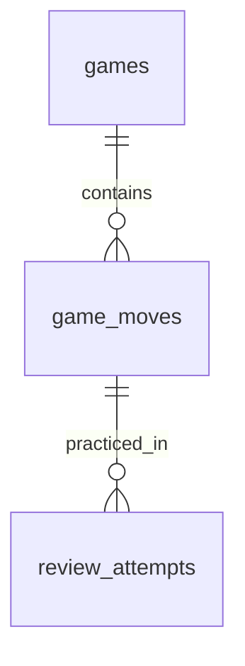

# Analytics storage contract

The complete field types, nullability, constraints and indexes are in `backend/schema.sql`.

## Dashboard summaries

The Analytics tab reads seven persisted tables. Every table has one row per
`(username, time_class, time_control_raw)`, plus `calculation_version` and
`updated_at`. Source decisions remain in `game_moves`; summaries contain no
per-game records and can be rebuilt without an engine or model request.

| Table | Stored measures |
| --- | --- |
| `analytics_tactical` | Eight counts: four motifs × missed/allowed |
| `analytics_decision_context` | Attack, Defend, Improve, Convert counts |
| `analytics_piece_comparison` | Named JSONB matrix: actual piece → engine-preferred piece → count |
| `analytics_context_outlook` | Named JSONB matrix: five outlooks → four contexts → count |
| `analytics_phase` | Error and eligible-move counts for three phases |
| `analytics_sharpness` | Error and eligible-move counts for five sharpness categories |
| `analytics_outlook` | Error and eligible-move counts for five outlook categories |

Only the selected player's decisions are eligible, even though engine analysis
covers both colors. Completed evidence must match the current PGN hash. Errors
are Inaccuracy, Mistake and Blunder; Best, Excellent and Good also count in rate
denominators. Uncertain and missing grades count in neither. Missing sharpness
or outlook excludes a move from that metric only. Coach charts require supported
saved classifications; absent historical objectives are never inferred. A
positional review without an objective can still contribute its known piece pair
to the heatmap. The engine-preferred piece is identified from rank one's origin
square on the saved pre-move board, including pawn promotions and king castling.

Outlook uses the exact pre-move rank-one evaluation, converted from stored White
perspective to the player/mover: Losing below −300 cp, Worse from −300 to below
−50, Equal from −50 through +50, Better above +50 through +300, Winning above
+300. Forced mates map to Winning or Losing; missing/bounded scores do not get
an outlook. All five bands remain in storage; only the positional chart combines
Worse into Losing and Better into Winning. Combined time-control rates divide
the summed error counts by summed eligible-move counts. Zero denominators are
displayed as no data, never as zero percent.

The `dashboard_analytics_v1` startup migration backfills existing profiles once.
Imports (including source/time-control changes), saved engine results, saved
game-linked coach reviews, and resets rebuild affected players in the same
transaction as the source change. A per-player advisory lock serializes rebuilds;
one source query provides their snapshot. Rebuilds replace all seven sets of rows,
removing obsolete controls, with a shared timestamp. Reads use a repeatable-read
snapshot so they cannot mix generations from different tables.

`GET /api/analytics?username=...` reads summaries; `POST
/api/analytics/refresh?username=...` rebuilds and returns them. Page-load refresh
runs independently of game syncing, and the Analytics page offers manual refresh
and reads saved updates every ten seconds while visible. Sync failure cannot
prevent refresh from saved evidence. Newly imported but unanalyzed games establish
zero-count time-control rows without launching analysis.

## Phase ownership

| Phase | Trigger | Reads | Writes |
| --- | --- | --- | --- |
| 1: import | Import or account sync | Provider payload and PGN | `games` source fields and every `game_moves` source/clock/board field |
| 2.0: engine | Analyze/resume game, or explicit game-linked coaching needing evidence | Recorded pre-move position and original UCI | Per-move top-five and played CP/mate/depth/bound/PV columns, search provenance, status and final-board evidence |
| 2.5: metrics | Successful evidence persistence; complete timeline | Saved engine scores | Move quality, pre-move sharpness score/classification, both game accuracy fields |
| 3: coaching | Selected player error, or explicit game-linked coach request | Position, preceding move, approved engine moves, original move | Explanations, candidates, category and subcategory, exact raw response, model/usage/version metadata |
| 4: practice | Legal submission or deliberate repeat review | Original `move_id` and pre-move position | Review session and ordered submissions, including the final Best, Excellent or Good move |

All schema columns exist from the start. Import creates source rows; engine and coaching enrich them. Practice creates separate session rows. Import never starts an engine or model request. Whole-game analysis evaluates both colors, completes accuracy, then coaches only the selected player's inaccuracies, mistakes and blunders. Direct coaching saves new engine evidence before contacting the model, so a model failure does not lose completed phase 2 work.

## Identities and conventions

- `games.game_id` is a stable internal identifier. Deduplicate by provider identity, falling back to source URL. Player identity and game-time ratings stay on the game.
- `game_moves.move_id` is stable across identical reimports. `(game_id, decision_ply)` is unique. The decision index starts at zero regardless of the starting full-move number or color.
- Source changes replace the recorded sequence and invalidate its downstream data atomically. Resetting analysis preserves source rows and move IDs.
- Stored engine evaluations use White's perspective. Each score populates exactly one of CP or mate. Black conversion negates scores and swaps lower/upper bounds, without changing candidate ranks. Unused candidate slots are null.
- The played move reuses a matching candidate's score, depth, bound and PV. Rank one supplies the pre-move evaluation. The final board has separate evidence on the last move; mate-in-zero retains its winner.
- Search metadata records limits, threads, hash, root scope, MultiPV, FEN-only history mode, evidence format and calculation policies. Optional comparison evidence retains original and recheck searches, also White-relative.
- Missing values remain null, including unsupported clocks and unavailable accuracy/sharpness. Uncertain means a move was graded but the evidence could not establish a reliable grade.
- `move_quality` stores Best, Excellent, Good, Inaccuracy, Mistake, Blunder or Uncertain using the shared player-move classifier. Exact comparable score ties are Best; other CP losses below 2.5 percentage points are Excellent, and losses from 2.5 to below 5 are Good. Mate scores follow the classifier's separate mate rules.
- `material_balance_before` is mover-relative, using 1/3/3/5/9; engine perspective does not change this convention. Game phase uses the existing sequential board-based rules.
- Timestamps are UTC-aware. PGN elapsed annotations take precedence over clock arithmetic. Supported base/increment controls use previous clock plus increment minus current clock; unknown initial clocks are not invented.

## Coaching

One current successful response belongs to each recorded move. `coach_output_raw` is the unmodified returned JSON text; queryable fields are populated after validation. The model category and subcategory populate `coach_error_category` and `coach_error_subcategory` directly. Positional errors use `positional` with Attack, Defend, Improve, or Convert; tactical errors retain their motif subcategories. Piece metadata remains separate. The one-time `coach_positional_objectives_v1` migration renames saved `other` errors to `positional`, moves their saved decision context into the subcategory, and removes `coach_decision_context`. Missing historical objectives stay null; raw responses and review history are preserved. Analytics counts positional decision contexts using these saved objectives.

The metadata retains model, response ID, usage, generation time, contract/classification/sharpness versions, prior-move context and the engine evidence identity. A failed or stale generation cannot erase or replace successful coaching. Game-linked reads do not borrow standalone responses from another context.

## Review sessions

`review_attempts` contains `review_id`, `move_id`, `review_number`, `created_at`, `status`, and `tried_moves`. Each ordered JSON entry contains `uci`, `quality`, and `grading_status`. It also has an operational `submission_id` for idempotent retries; this is not another analytics measure.

Every submission starts from the same original position, rather than continuing the previous trial. A graded Best, Excellent or Good move completes a session. Technical failures remain failed/ungraded and do not count as bad chess moves. Reopening resumes the latest session; a deliberate repeat creates the next number. A unique active-session index and transactional locks prevent duplicate concurrent sessions and lost appends. Restarted workers mark abandoned pending grades as failed so practice can continue.

Game detail includes the latest sessions for immediate restoration. The practice GET endpoint also returns full session history for that move. Browser storage is no longer the source of practice history; old browser attempts are not imported.

## Supporting storage and reset safety

- `analysis_jobs`: status and coaching progress per game/player, no duplicate move-evidence blobs.
- `profiles`, `profile_games`, `http_cache`: account sync and conditional provider requests.
- `coach_feedback`: standalone FEN/final-board commentary, where no recorded move owns the response.
- `multi_game_analysis`: cross-game job/report history and input snapshots.
- `schema_migrations`: applied schema markers.

The extra `games.analysis_revision` is a reset-generation guard; `games.statistics_version` identifies the accuracy policy. They are operational metadata beyond the PDF's analytics fields. Every worker write checks its source/reset identity. Reset clears move analysis, linked reviews, relevant reports and progress in one transaction. A previously running worker cannot restore them after reset or PGN replacement.

## Clean cutover

On the first startup against the retired `games.id` layout, the schema transaction drops only this application's named legacy tables, then creates the new schema. Existing data is intentionally discarded, as authorized. No backfill or dual writes are used. The old SQLite auto-import and volume mount are removed. Subsequent starts detect the new layout and preserve its data. The app remains a local single-user, single-API-worker service.

The Best/Excellent upgrade expands the existing move-quality constraint and recalculates stored move grades once from saved engine evidence. It updates the recorded grading policy without rerunning Stockfish or the coach. Source data, raw scores, accuracy, sharpness, coaching and review history remain intact.

Validation uses disposable PostgreSQL schemas, engine fixtures, mocked model responses and a real Stockfish game. No paid model call is needed for migration verification.
